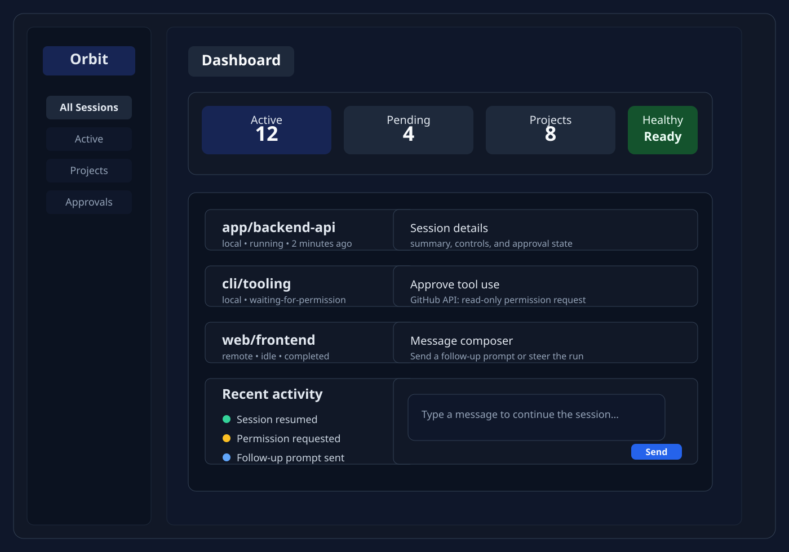
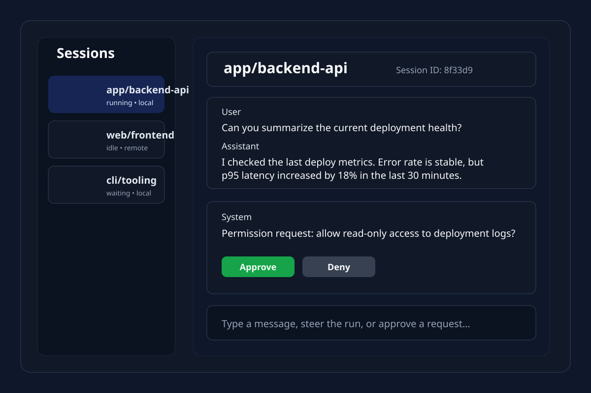

# Copilot Orbit

Copilot Orbit is a VS Code extension for discovering, inspecting, and controlling GitHub Copilot sessions from inside the editor. It gives you a single dashboard for browsing sessions, reading conversation history, approving runtime requests, and continuing work without switching tools or terminals.

> Copilot Orbit works with sessions that the Copilot SDK can surface and control. Some runtime behaviors depend on the underlying Copilot implementation and may be limited.

## What the extension does

Copilot Orbit helps you:

- discover Copilot sessions created locally or remotely,
- inspect project-level session context,
- view recent conversation history in a readable dashboard,
- respond to approval or input requests while staying in VS Code,
- manage active runs and resume previously discovered sessions,
- keep a clearer overview of what is running, waiting, or completed.

It is designed for developers who want more visibility into Copilot activity without leaving their editor.

## Features

### Session dashboard

The main dashboard gives you a single control surface for your Copilot sessions.



Key capabilities:

- browse all sessions and recent activity,
- group sessions by project context,
- filter by active, pending, project, or approval state,
- see health summaries for local runtime state,
- launch session detail views directly from the dashboard.

### Session detail and approval flow

Each session can be opened to inspect the latest conversation and control the current run.



Key capabilities:

- read conversation history in a structured panel,
- see whether a session is active, waiting for permission, or completed,
- approve or deny requests as they arrive,
- send follow-up prompts or continue a session in place,
- view the working timeline without needing external dashboards.

### Core feature list

- Session discovery across local and remote sources
- Quick resume and open-session actions
- Active session list and project grouping
- Pending approval queue with clear status
- Conversation history with markdown-safe rendering
- Message sending and run cancellation support when the runtime allows it
- Local-only metadata such as favorites and archive markers
- Privacy-focused behavior with no transcript persistence in extension storage

## Installation

### Prerequisites

- VS Code 1.95.0 or later
- Node.js 20.19.0 or later for development
- A compatible GitHub Copilot runtime available to the Copilot SDK

### Install from Marketplace

1. Open the VS Code Extensions view.
2. Search for `Copilot Orbit`.
3. Click Install.
4. Reload the window if prompted.

### Install from source

```bash
git clone https://github.com/mohammadamer/copilot-orbit.git
cd copilot-orbit
npm install
```

### Custom CLI path

If you want to use a custom Copilot CLI instead of the bundled SDK runtime:

1. Open VS Code Settings.
2. Search for `Copilot Orbit: CLI Path`.
3. Enter the full path to the CLI executable.
4. Reload VS Code.

## Usage examples

### Open the dashboard

```text
Command Palette → Copilot Orbit: Open Dashboard
```

You can also open the activity bar container named `Copilot Orbit` and focus the dashboard or session tree views.

### Create a new session

```text
Command Palette → Copilot Orbit: Create Session
```

Then select a project directory if prompted. The new session appears in the dashboard and can be opened immediately.

### Resume an existing session

```text
Command Palette → Copilot Orbit: Resume Session
```

Pick a session from the list, then continue the conversation or inspect the details that are already available.

### Handle an approval request

```text
Activity Bar → Pending Approvals
```

Click the approval request and decide whether to approve or deny it. This keeps permission handling in the editor context instead of forcing you to switch to another console or UI.

### Send a follow-up prompt

Open a session and type a message in the composer. When the runtime supports it, the extension sends the message and updates the session state.

## Configuration options

The extension exposes the following settings:

| Setting | Type | Default | Description |
| --- | --- | --- | --- |
| `copilotSessions.autoRefresh` | boolean | `true` | Automatically refresh the session catalog |
| `copilotSessions.refreshInterval` | number | `30` | Fallback refresh interval in seconds |
| `copilotSessions.groupByProject` | boolean | `true` | Group sessions by project context |
| `copilotSessions.showWorkingTimeline` | boolean | `true` | Show tool activity in the working timeline |
| `copilotSessions.confirmBeforeCancel` | boolean | `true` | Require confirmation before cancelling a run |
| `copilotSessions.logLevel` | string | `info` | Diagnostic logging level (`error`, `warn`, `info`, `debug`) |
| `copilotSessions.cliPath` | string | empty | Optional path to a custom Copilot CLI |

## Known issues and limitations

Some features are intentionally constrained by the underlying Copilot runtime and SDK:

- session control depends on what the runtime can expose,
- some sessions may be visible but not controllable,
- resume behavior is runtime-dependent,
- plan approval and some cross-device workflows are not yet supported,
- session data remains in memory and is not persisted by the extension,
- some Linux environments may require additional runtime dependencies for Electron-backed VS Code behavior,
- shutdown of VS Code can interrupt active sessions when the underlying SDK connection ends.

When a session does not behave as expected:

1. refresh the session list,
2. confirm the CLI path is valid,
3. reopen the dashboard if the state looks stale,
4. try resuming the session if the runtime supports it.

## Usage guide and docs

For longer-form walkthroughs and reference material, see:

- [docs/USAGE.md](docs/USAGE.md)
- [docs/CONTRIBUTING.md](docs/CONTRIBUTING.md)

## Development

### Project structure

```text
copilot-orbit/
├── src/                     # Extension host and SDK orchestration
│   ├── extension.ts         # Activation and command registration
│   ├── domain/              # Shared message and session models
│   └── services/            # Facade, providers, and state management
├── webview-ui/              # React dashboard UI
├── docs/                    # Documentation and usage references
├── resources/               # Icons and static assets
├── tests/                   # Test suites
├── package.json             # Extension metadata and scripts
├── README.md                # Extension landing page
├── LICENSE                  # MIT license
└── PRD.md                  # Product requirements and design context
```

### Common commands

```bash
npm run build
npm run watch
npm run typecheck
npm test
npm run lint
npm run package
```

## Contribution guidelines

We welcome contributions that improve reliability, UX, or clarity.

1. Fork the repository and create a feature branch.
2. Keep the scope focused and avoid unrelated refactors.
3. Update docs when behavior changes.
4. Run the relevant validation commands before opening a PR.
5. Use clear, conventional commit messages.

Recommended validation:

```bash
npm run lint
npm run typecheck
npm test
```

Use commit messages such as:

- `feat: add session approval panel`
- `fix: handle stale session refresh state`
- `docs: improve installation and usage guides`

For more detailed contributor guidance, see [docs/CONTRIBUTING.md](docs/CONTRIBUTING.md).

## License

This project is licensed under the MIT License. See [LICENSE](LICENSE) for details.

## Questions or support

If you hit a problem, open a GitHub issue with:

- your VS Code version,
- the extension version,
- the exact workflow you used,
- any relevant runtime or console logs.
